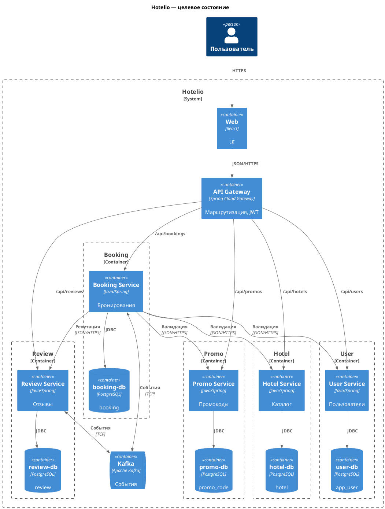

# ADR-001: Переход Hotelio на микросервисы (Strangler Fig)

| Поле | Значение |
|---|---|
| Статус | Принято |
| Дата | 2026-10-19 |
| Автор | Владислав Гриша |

## 1. Контекст
Монолит Spring Boot + одна PostgreSQL (`app_user`, `booking`, `hotel`, `promo_code`, `review`). Модули вызывают друг друга в памяти. Единый деплой, единая точка отказа. НФТ требуют независимого масштабирования и добавления функционала без изменения существующего.

## 2. Проблемы
| № | Проблема | Следствие |
|---|---|---|
| P1 | God Object в `BookingService` (оркестрирует 4 модуля) | высокий риск регрессий |
| P2 | Shared Database | нельзя менять схему независимо |
| P3 | Единая точка отказа | падение = весь продукт недоступен |
| P4 | Нельзя масштабировать Booking отдельно | переплата за ресурсы |
| P5 | Прямые синхронные вызовы модулей | нельзя вынести модуль без правки вызывающих |
| P6 | Нет изоляции сбоев | медленный Review блокирует Booking |
| P7 | Единый релиз | нельзя катить точечные изменения |

## 3. Альтернативы
| № | Вариант | Вердикт |
|---|---|---|
| A1 | Big Bang rewrite | ❌ риск, долго |
| A2 | Modular Monolith | ❌ не решает P3, P4, P7 |
| A3 | **Strangler Fig** | ✅ принято |
| A4 | Parallel run | ⚠️ тактика для критичных шагов |

## 4. Решение
- **API Gateway** (Spring Cloud Gateway) — единая точка входа.
- **Kafka** — асинхронные события домена.
- **Booking Service** + своя `booking-db` — первый извлекаемый модуль.
- Остальные модули (`User`, `Hotel`, `Promo`, `Review`) пока в монолите.
- Наблюдаемость: OpenTelemetry + Prometheus + Grafana.

### Целевое состояние (C4 Container)

## 5. Почему первый модуль — Booking
1. Центральный бизнес-поток (создание ценности).
2. Самый большой God Object — максимум эффекта от выноса (P1, P5).
3. Единственный write-heavy модуль — реальный драйвер масштабирования (P4).
4. Чёткий bounded context — сущность `booking` целиком его.
5. Максимальная конкуренция за блокировки БД — снимаем через свою БД (P2).
6. Создаёт инфраструктурный шаблон (Gateway, Kafka) для остальных.
7. В проекте уже есть заготовки.

**Почему не другие:** `User`/`Hotel`/`Promo`/`Review` — read-heavy и малые; их вынос даст мало выгоды без готового шаблона.

## 6. Последствия
**Плюсы:** независимое масштабирование Booking; своя БД убирает блокировки; изоляция сбоев; независимые релизы; шаблон для остальных; событийная модель открывает путь к уведомлениям/BI.

**Минусы:** распределённые транзакции (нужны Saga + idempotency); сетевые задержки; операционная сложность; временное дублирование данных.

## 7. Риски и митигации
| № | Риск | Митигация |
|---|---|---|
| R1 | Расхождение данных при переходе | Debezium CDC + reconciliation job |
| R2 | Рост latency | Caffeine-кэш справочников + Resilience4j |
| R3 | Дубли бронирований при retry | Idempotency-Key + уникальный индекс |
| R4 | Gateway = SPOF | 2+ инстанса за LB |
| R5 | Kafka = SPOF | 3 брокера, RF=3, DLQ |
| R6 | Потеря событий | DLQ + мониторинг лага |

## 8. Вне scope
JWT/OAuth2 на Gateway, Schema Registry (Avro), Kubernetes, multi-tenancy — отдельные ADR.